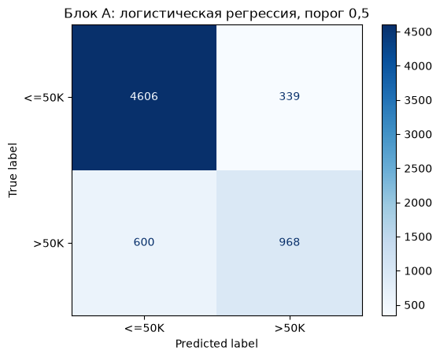
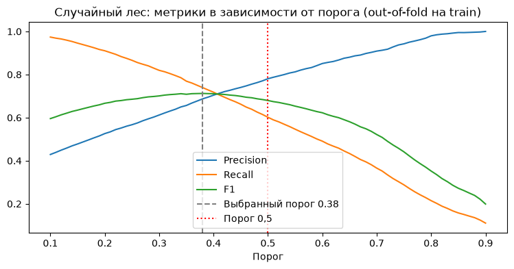
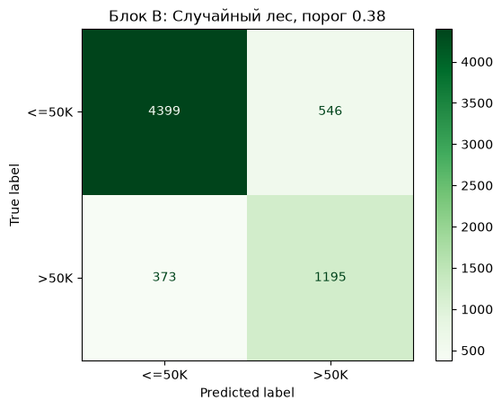
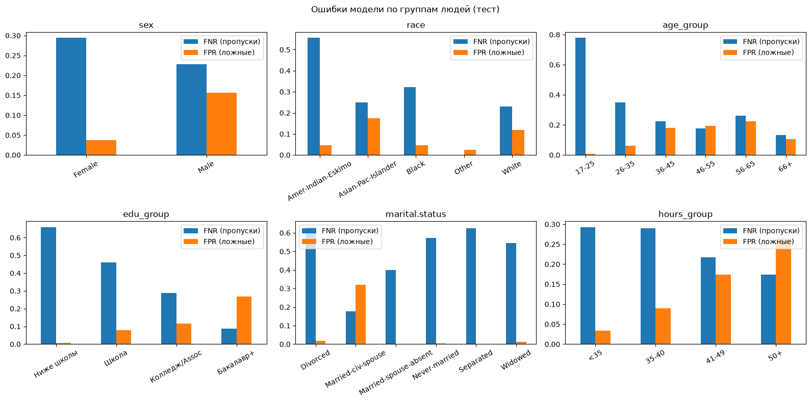

# Модуль 1. Проект 3: уровень дохода

Модуль 1, часть Б, командный проект № 3. Выполнены все три блока: A (базовый), B (основной) и C (продвинутый).

## Команда

| Участник | Уровень | Что делал |
| --- | :-: | --- |
| Эркинбеков Айман | C | Код: блок A, в блоке B пайплайн, две модели, метрика, порог и вывод |
| Айжигит | B | Код: в блоке B разведочный анализ (EDA), блок C целиком |
| Омурбек | | Презентация |
| Адильхан | A | Питчинг (защита проекта) |

Код писали Айман и Айжигит вместе, все три блока. В notebook у каждой части и у каждой ячейки кода указан автор.

## Задача

Данные: `adult.csv`, 32 561 человек из переписи населения США. Цель `income`: доход больше 50 000 долларов в год (`>50K`) или нет. Пропуски в файле записаны знаком `?`.

Заказчик: банк. По модели он решает, кому предложить премиальную кредитную карту. Если предложить карту человеку с низким доходом, будет отказ и расходы на рассылку. Если пропустить человека с высоким доходом, банк теряет выгоду. По словам заказчика, эти ошибки стоят примерно одинаково, поэтому главная метрика: F1 для класса `>50K`.

## Что сделано

| Блок | Что сделано |
| --- | --- |
| A | Загрузка с `na_values="?"`, разбиение `train_test_split(test_size=0.2, stratify=y, random_state=42)`, заполнение пропусков самым частым значением, `OneHotEncoder` и `StandardScaler`, логистическая регрессия, матрица ошибок |
| B | EDA (пропуски, скрытые пропуски, выбросы, дубли), `Pipeline` + `ColumnTransformer` без утечки, логистическая регрессия и случайный лес на `StratifiedKFold(5)`, метрика F1, подбор порога, проверка на отложенном тесте |
| C | Поиск всех проблем данных и утечек, три метода против дисбаланса внутри кросс-валидации, анализ ошибок по группам людей, ограничения модели для кредитного решения |

## Результаты

Отложенный тест, 6513 человек:

| Модель | F1 | Recall | Precision | ROC-AUC | Accuracy |
| --- | --- | --- | --- | --- | --- |
| Блок A: логистическая регрессия, порог 0,5 | 0,673 | 0,617 | 0,741 | 0,908 | 0,856 |
| Блок B: случайный лес, порог 0,5 | 0,697 | 0,622 | 0,793 | 0,922 | 0,870 |
| **Блок B: случайный лес, порог 0,38** | **0,722** | **0,762** | 0,686 | 0,922 | 0,859 |

Матрица ошибок базовой модели (блок A). Модель нашла 968 из 1568 людей с доходом больше 50K, то есть 61,7%:



Подбор порога. Порог выбран по максимуму F1 на прогнозах train вне фолда, тест в подборе не участвовал:



Итоговая модель на тесте, случайный лес с порогом 0,38:



Ошибки по группам людей (блок C):



Другие проверки на кросс-валидации (F1):

| Вариант | F1 |
| --- | --- |
| Все признаки | 0,680 |
| Без `capital.gain` и `capital.loss` | 0,623 |
| Без пола, расы, страны, семейного положения и `relationship` | 0,591 |
| `class_weight="balanced"` / oversampling / undersampling, лучший порог | 0,709 / 0,712 / 0,707 |

## Выводы

1. Accuracy здесь плохо подходит: 76% людей получают до 50K, и модель, которая всем отвечает «до 50K», уже даёт 0,76.
2. Случайный лес лучше логистической регрессии: F1 на кросс-валидации 0,680 против 0,659.
3. Порог 0,38 поднял recall с 62% до 76%. Банк найдёт 3 из 4 людей с высоким доходом, а 2 из 3 предложений попадут в цель. Если банк считает ошибки строго равными по деньгам, лучше порог около 0,45-0,5, при нём меньше всего ошибок в сумме.
4. `capital.gain` и `capital.loss` входят в сам доход, и банк их обычно не знает. Без них F1 падает до 0,623, это более честная оценка для банка.
5. Методы против дисбаланса дают тот же F1 около 0,71, что и простой подбор порога. Оставили самый простой вариант.
6. Модель чаще пропускает людей с высоким доходом среди молодых, без высшего образования, не состоящих в браке и среди женщин. Чаще зря предлагает карту женатым мужчинам.
7. Пол, расу, страну рождения и семейное положение нельзя использовать в кредитном решении. Без них F1 0,591. Данные 1994 года и только по США, поэтому перед реальным использованием модель нужно переобучить на клиентах банка.

Модель можно использовать для отбора людей на рассылку, но только без защищённых признаков и после переобучения на свежих данных.

## Как запустить

Одна команда из корня репозитория на Ubuntu:

```bash
bash modul1/run.sh
```

Скрипт сам ставит `python3` и `python3-venv`, если их нет (на Ubuntu через `apt-get`), создаёт окружение `modul1/.venv`, ставит библиотеки из `modul1/requirements.txt`, выполняет notebook и сохраняет вывод в `modul1/evidence/`, а графики в `modul1/images/`. Работает около 2 минут, без учёта установки библиотек.

Запуск проверен на чистом образе Docker `ubuntu:24.04`, лог лежит в `evidence/clean_ubuntu_run.txt`.

Notebook можно открыть и вручную: в VS Code выбрать ядро `modul1/.venv`, затем Restart и Run All.

## Структура

```text
modul1/
├── README.md                     # этот файл
├── run.sh                        # запуск одной командой
├── requirements.txt              # библиотеки с версиями
├── data/adult.csv                # исходные данные
├── notebooks/project3_income.ipynb  # код, графики и выводы по блокам A, B, C
├── images/                       # графики для README (создаёт run.sh)
└── evidence/                     # сохранённый вывод команд
    ├── run_log.txt               # вывод run.sh
    ├── notebook_output.txt       # текстовый вывод всех ячеек notebook
    └── clean_ubuntu_run.txt      # запуск с нуля в Docker ubuntu:24.04
```
